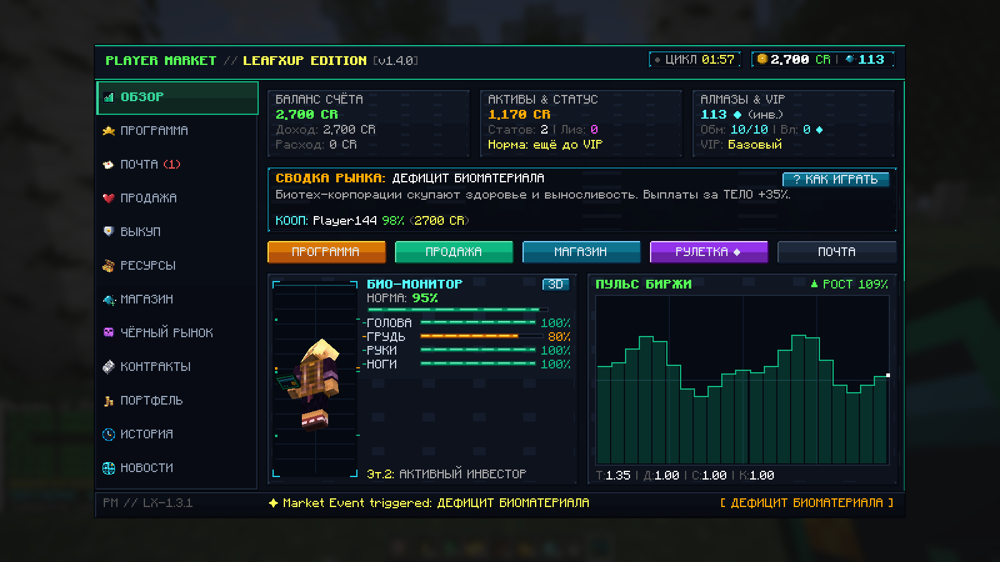
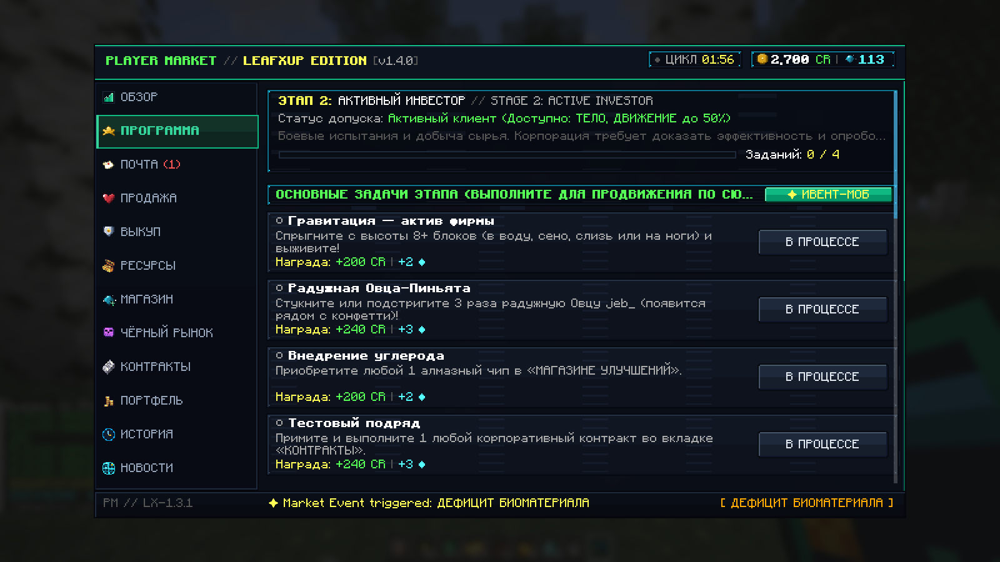
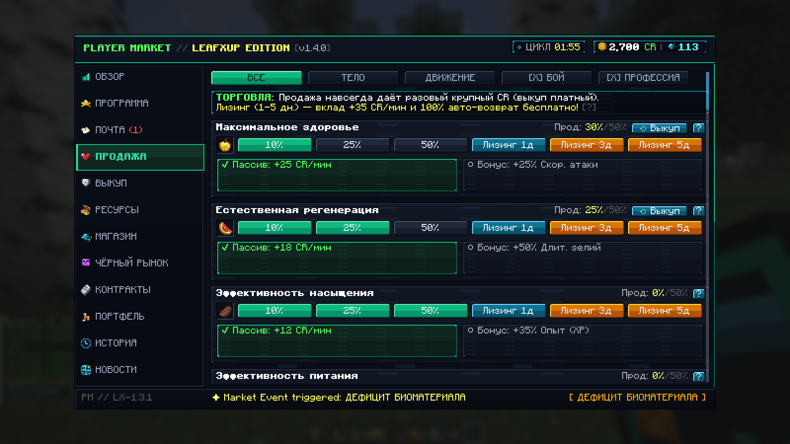
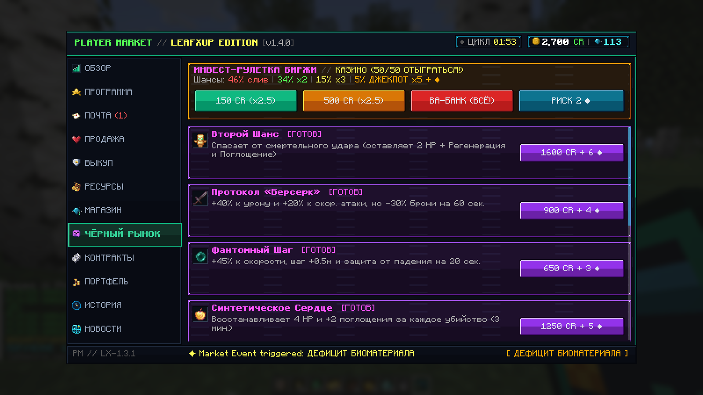
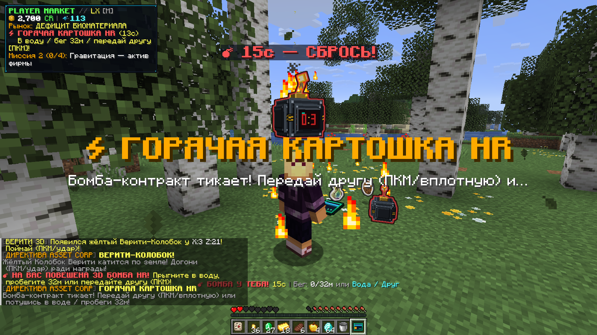
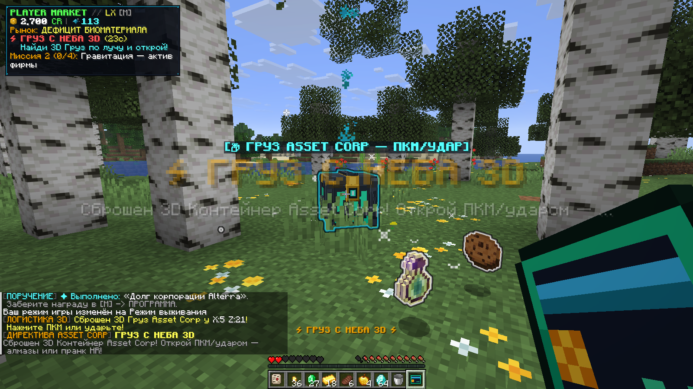
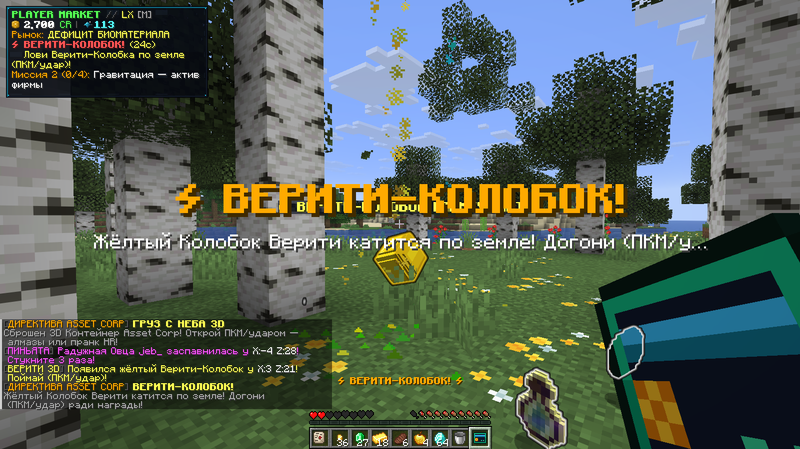
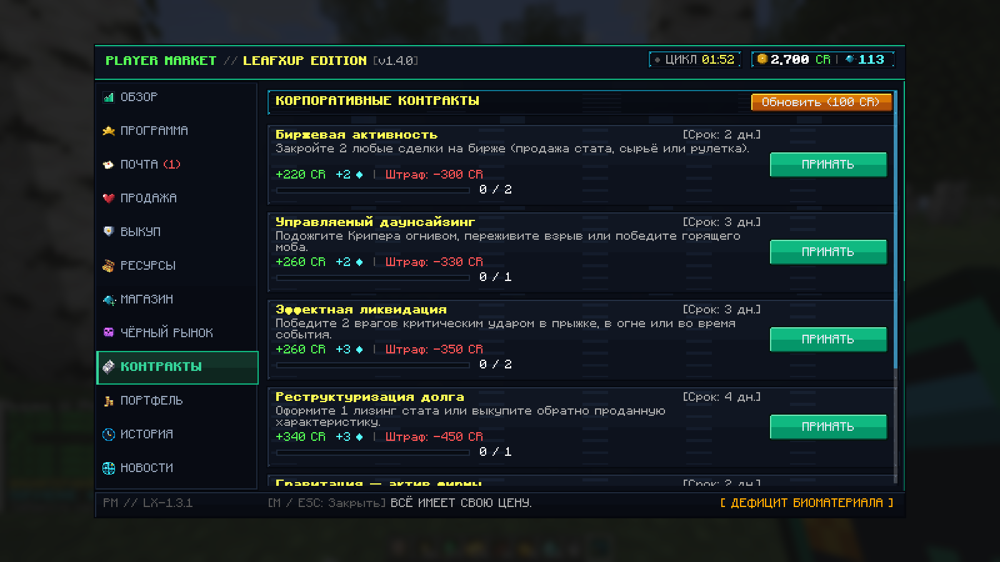

# Player Market: Leafxup Edition `v1.4.0-leafxup` (Minecraft `26.3` · Fabric)

> **ВСЁ ИМЕЕТ СВОЮ ЦЕНУ.** Специальное кооперативное издание с высокой динамикой, 3D-объектами хаоса, синхронными ивентами каждые 12–20 секунд, рулеткой 50/50, процентными штрафами и финалом по **Статье 17.4**.

---

## Скриншоты интерфейса и 3D-ивентов

| Обзор терминала и 3D Био-монитор | Программа и кнопка призыва `✦ ИВЕНТ-МОБ` |
| :---: | :---: |
|  |  |
| **Продажа статов, лизинг и выкуп** | **Чёрный рынок и Инвест-Рулетка 50/50** |
|  |  |
| **3D Бомба «Горячая картошка» HR** | **3D Груз Снабжения и Кооп-HUD** |
|  |  |
| **3D Верити-Колобок в мире** | **Контракты с процентными штрафами** |
|  |  |

---

## Системные требования

- **Minecraft Java Edition**: `26.3`
- **Загрузчик модов**: Fabric Loader `>= 0.20.1`
- **Зависимости**: Fabric API (`0.165.2+26.3` или совместимая)
- **Java**: Java `25`
- **Установка**: требуется **на клиенте и на сервере** (одиночная игра, LAN-кооп и выделенные серверы)
- **Совместимость**: встроенная синергия с модом **Upgrader Items** (стартовый апгрейдер и приём алмазов)

---

## Что нового в `v1.4.0-leafxup` (Streamer Chaos Rebalance & 3D Update)

### 1. Стримерский ребаланс Хаоса (вдохновлён *Entropy* / *Chaos Mod*)
- **Частота и приоритет 3D-ивентов**: интервал между директивами сокращён до **`12–20` секунд** (`chaosIntervalMinTicks = 240`, `Max = 400`, `configVersion = 5`), а в пуле событий приоритет (`~73%`) отдан зрелищным **3D-моделям**, взрывам и мировым интерактивам:
  - **3D Бомба «Горячая картошка» HR** — тикающая бомба кружит прямо перед игроком (`x0.65` орбитальный маячок на уровне глаз + таймер над головой);
  - **3D Груз Снабжения (`SUPPLY_OR_MIMIC`)** — контейнер с алмазами, золотым яблоком или весёлым пранком HR;
  - **3D Взлом Банкомата (`VAULT_HEIST`)** — пробей сейф 6 раз за 22 сек до штрафа;
  - **3D Орбитальный Дрон HR (`DRONE_STRIKE`)** — исправлен круг: теперь за `1.9` сек до выстрела дрон **жёстко фиксирует красный круг на земле (`3.0м`)** и не тянется за игроком, позволяя честно выбежать и получить бонус за уклонение;
  - **3D Верити-Колобок (`prop_verity_kolobok`)** — переработан в катящегося по земле жёлтого колобка (без зависаний в небе и мгновенного исчезновения вне активной директивы);
  - **3D Корона на лидере (`BOUNTY_HUNT`)** и камера наблюдения **CCTV HR**.
- **Память последних 3 событий**: как в моде *Entropy*, ни одна из 3 предыдущих директив не повторяется подряд.

### 2. Баланс скорости мобов и анти-фарм кнопка призыва в «ПРОГРАММЕ»
- **Адекватная скорость мобов**: у Свинки-Копилки убран бафф `Speed II`, а скорость убегания Свинки, Радужной Пиньяты (`jeb_`) и Верити-Колобка снижена до комфортной (`~1.1–2.5` бл/с) — их реально догнать даже после продажи скорости в терминале.
- **Кнопка `✦ ИВЕНТ-МОБ` на вкладке «ПРОГРАММА»**: позволяет сразу призвать нужного ивент-моба текущего этапа (Свинку, Пиньяту, Инспектора, Курьера, Верити или 3D-груз), не дожидаясь случайного спавна.
  - **Строгая защита от бесконечного фарма**: кнопка блокируется, если в мире уже живёт любой ивент-моб или 3D-объект, если идёт директива хаоса, и имеет общий откат **`35` секунд**.

### 3. Усиленная экономика штрафов и прогрессия
- Процентные штрафы (`scaleFine`: минимум база ИЛИ процент от баланса CR — от `5%` до `22%`), мотивация продавать характеристики ради био-множителя, алмазов и скидок в магазине.
- Полная остановка контрактов, поручений и директив хаоса после закрытия **Финального расчёта по Статье 17.4**.

---

## Установка и скачивание

- **`playermarket-1.4.0-leafxup.jar`** — основной файл мода (поместите в папку `mods/` клиента и сервера)
- **`playermarket-1.4.0-leafxup-sources.jar`** — исходники и API для разработчиков

> При обновлении со старых версий удалите предыдущий `playermarket-*.jar` из `mods/`. Конфиг `config/playermarket.json` автоматически мигрирует до `configVersion = 5`.
