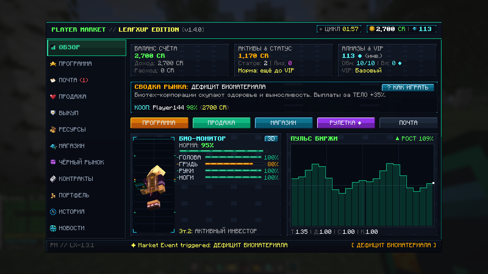
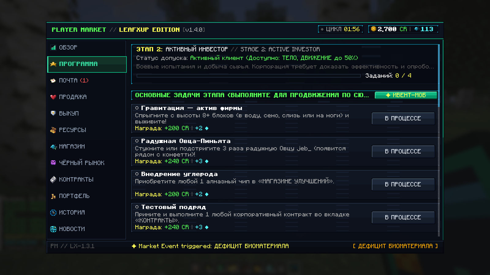
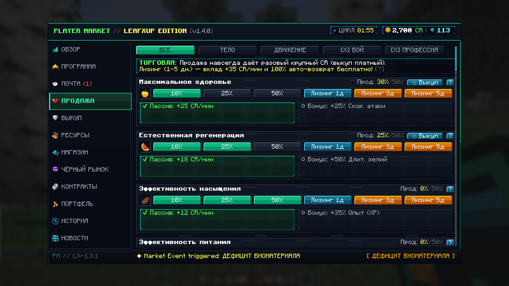
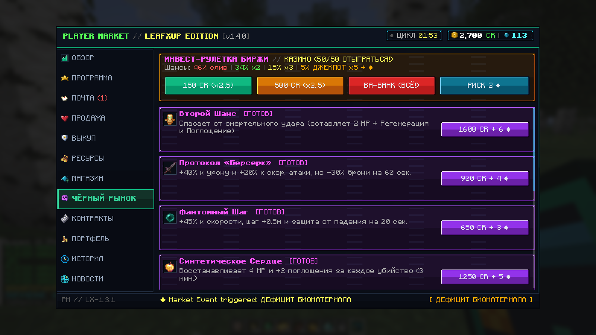
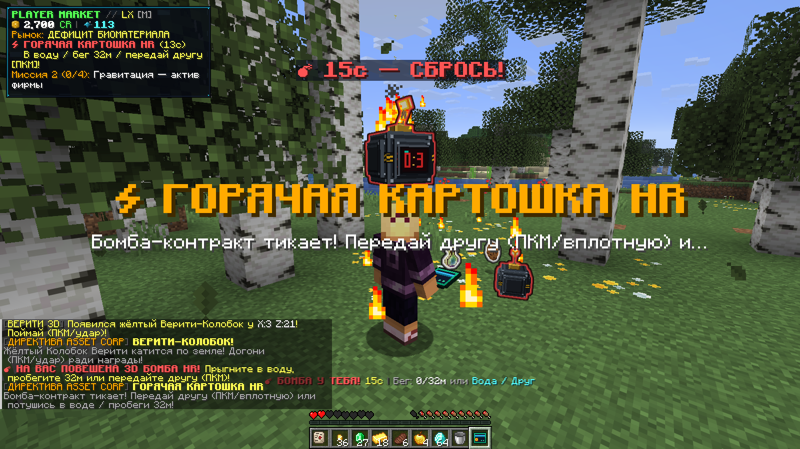
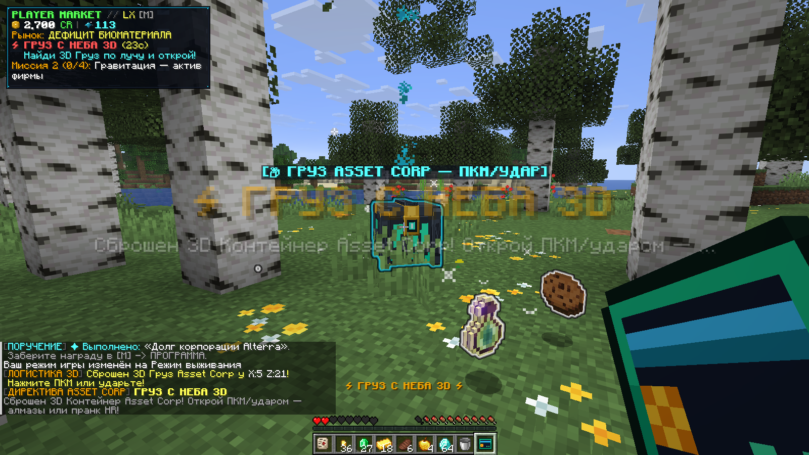
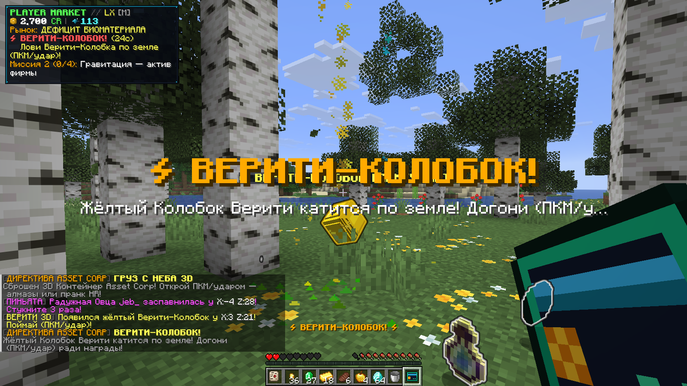
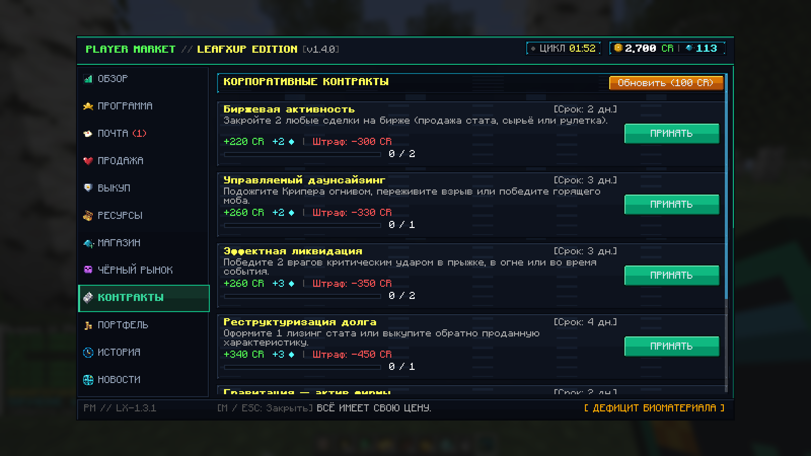

# PLAYER MARKET: Leafxup Edition

> **ВСЁ ИМЕЕТ СВОЮ ЦЕНУ.** Твоё тело, твои статы, наша биржа.

Кооперативный RPG-экономический Fabric-мод для **Minecraft Java Edition `26.3`**, переработанный под быстрый, хаотичный и зрелищный кооп-формат (20–30 минут на полное прохождение): продавайте собственные характеристики за **CR**, крутите **Рулетку 50/50**, ловите сбегающих Свинок-Копилок и Куриц-Курьеров, переживайте **Директивы Хаоса** и подписывайте мелкий шрифт **Статьи 17.4**.

[](#требования)
[](#требования)
[](LICENSE)
[](https://github.com/nexWay2040/playermarket-minecraftmod/releases/tag/v1.4.0-leafxup)

---

## Скриншоты интерфейса и 3D-ивентов

| Обзор терминала и 3D Био-монитор | Программа и кнопка призыва `✦ ИВЕНТ-МОБ` |
| :---: | :---: |
|  |  |
| **Продажа статов, лизинг и выкуп** | **Чёрный рынок и Инвест-Рулетка 50/50** |
|  |  |
| **3D Бомба «Горячая картошка» HR** | **3D Груз Снабжения и Кооп-HUD** |
|  |  |
| **3D Верити-Колобок в мире** | **Контракты с процентными штрафами** |
|  |  |

---

## Содержание

- [Скриншоты интерфейса и 3D-ивентов](#скриншоты-интерфейса-и-3d-ивентов)

- [Игровой цикл](#игровой-цикл)
- [Требования](#требования)
- [Ключевые особенности Leafxup Edition](#ключевые-особенности-leafxup-edition)
  - [1. Мятое письмо и скрытый пункт 17.4](#1-мятое-письмо-и-скрытый-пункт-174)
  - [2. Финансовый терминал, 3D/2D Био-монитор и Кооп-HUD](#2-финансовый-терминал-3d2d-био-монитор-и-кооп-hud)
  - [3. Директивы Хаоса и живые мировые события](#3-директивы-хаоса-и-живые-мировые-события)
  - [4. Инвест-Рулетка 50/50 и Чёрный рынок](#4-инвест-рулетка-5050-и-чёрный-рынок)
  - [5. Продажа статов, лизинг и обратный выкуп](#5-продажа-статов-лизинг-и-обратный-выкуп)
  - [6. Биржа ресурсов, алмазные чипы и 3D-сканер руд](#6-биржа-ресурсов-алмазные-чипы-и-3d-сканер-руд)
  - [7. Сюжетные этапы 1–6 и финал по Статье 17.4](#7-сюжетные-этапы-16-и-финал-по-статье-174)
- [Управление и команды](#управление-и-команды)
- [Конфигурация](#конфигурация)
- [Сборка из исходников](#сборка-из-исходников)
- [Лицензия и ресурсы](#лицензия-и-ресурсы)

---

## Игровой цикл

1. **Изучите Мятое письмо**: при входе в мир вы получаете корпоративный бланк договора (`playermarket:crumpled_letter`). Внизу мелким шрифтом спрятан кликабельный **пункт 17.4** с раскрытием всех последствий сделки.
2. **Синхронный старт команды**: как только один игрок подписывает договор, **все участники онлайн** сразу получают Карту Доступа к терминалу `[M]` и стартовые `+100 CR`.
3. **Продавайте статы и играйте на 50/50**: продавайте `10%`, `25%` или `50%` характеристик (или сдавайте во временный **Лизинг на 1 / 3 / 5 дней**), тратьте капитал в **Рулетку 50/50**, обменивайте руды/предметы и ставьте алмазные аугментации.
4. **Ловите 3D-ивенты и проходите 6 этапов**: каждые `12–20` секунд после завершения предыдущего ивента запускается одна из **24 Директив Хаоса** с приоритетом на 3D-бомбы, 3D-грузы снабжения, банкоматы, дрона HR и Верити-Колобка. На вкладке **«ПРОГРАММА»** доступна кнопка **`✦ ИВЕНТ-МОБ`** с защитой от фарма (КД 35 сек и лимит 1 активный ивент в мире).
5. **Финальный расчёт на 6-м этапе**: получите обещанный **+1 000 000 CR**, после чего вступает в силу **Статья 17.4** — экран блокируется, срабатывает аналоговый хоррор-скример, сервер отключает команду, а после перезахода на ноге остаётся **титановый ортопедический фиксатор**.

---

## Требования

- **Minecraft**: `26.3` (Java Edition)
- **Mod Loader**: Fabric Loader `>= 0.20.1`
- **Зависимости**: Fabric API (`0.165.2+26.3` или совместимая)
- **Java**: Java `25`
- **Среда**: мод обязателен на **Клиенте** и **Сервере** (одиночка, LAN и выделенные серверы)
- **Локализация**: полная поддержка **Русского (`ru_ru`)** и **Английского (`en_us`)** языков
- **Бонус**: автоматическая выдача и синергия с **Upgrader Items** (при наличии мода)

---

## Ключевые особенности Leafxup Edition

### 1. Мятое письмо и скрытый пункт 17.4
- Каждый новый игрок стартует с **Мятым письмом**; после подписания договора выдаётся недюпающаяся **Карта Доступа** (`playermarket:market_access_card`, исчезает при смерти, восстанавливается через `/market card` до финала).
- В самом тексте договора зашит малозаметный кликабельный **п. 17.4** с подробной справкой о грядущей конфискации активов.

### 2. Финансовый терминал, 3D/2D Био-монитор и Кооп-HUD
- 12 вкладок в стиле кибер-терминала: **Обзор**, **Программа**, **Почта**, **Продажа**, **Выкуп**, **Ресурсы**, **Магазин**, **Чёрный рынок**, **Контракты**, **Портфель**, **История** и **Новости**.
- **Гибридный 3D/2D Био-монитор**: переключайтесь между анимированной **3D-моделью вашего скина** с подсветкой повреждённых зон и подробной **2D-голограммой** (`Голова`, `Грудь`, `Руки`, `Ноги`).
- **Кооперативный HUD**: показывает CR, алмазы, активный рыночный цикл, обратный отсчёт текущей Директивы Хаоса, сонар руд и прогресс миссий команды.
- **Раздел «Новости»**: текущие макроэкономические сводки, игровые гайды, чёрный юмор о Майнкрафте и шуточные корпоративные заметки в духе видео `leafxup`.

### 3. Директивы Хаоса (`24` события) и кастомные 3D-модели
[`CorporateChaosDirector`](src/main/java/com/playermarket/story/CorporateChaosDirector.java) и [`ChaosProp3DManager`](src/main/java/com/playermarket/story/ChaosProp3DManager.java) каждые `12–20` секунд простоя активируют одно из **24 синхронизированных событий** с памятью последних 3 директив:
- **3D Груз Снабжения, Банкомат HR и Капсула** — кастомные 3D-объекты с подсветкой, голограммой и открытием по ПКМ/удару (`пробей сейф`, `алмазы` или `пранк-мимик HR`).
- **3D Бомба HR («Горячая картошка»)** и **3D Корона на лидере** — с орбитальным 3D-маячком на уровне глаз и передачей/сбросом.
- **3D Орбитальный Дрон HR** — наводит и фиксирует на `1.9` сек жёсткий красный круг на земле (`3.0м`), позволяя честно выбежать до удара.
- **3D Верити-Колобок**, **Мини-формат (`x0.48`)**, **Гигант бюджета (`x1.65`)**, **Лунная гравитация**, **Пружинный пол HR**, **Зарядка `8x Shift`**, **Аудит-лава**, **Турбо-смена** и **Паранойя Шредингера**.
- **Живые спавн-ивенты** (сбалансированная скорость передвижения + призыв по кнопке **`✦ ИВЕНТ-МОБ`** в «ПРОГРАММЕ» с КД 35 сек):
  - **Свинка-Копилка**, **Радужная Овца-Пиньята (`jeb_`)**, **Голодный Инспектор**, **Курица-Курьер на парашюте**, **Верити-Колобок 3D** и **Визит Коллектора Asset Corp**.

### 4. Инвест-Рулетка 50/50 и Чёрный рынок
- Всегда доступная **Инвест-Рулетка 50/50** в Обзоре и Чёрном рынке:
  - Ставки: `150 CR`, `500 CR`, `ВА-БАНК (ВСЁ!)` и `РИСК 2 ♦`
  - Исходы: `46%` проигрыш, `34%` `x2`, `15%` `x3`, `5%` **МЕГА-ДЖЕКПОТ `x5 + ♦`** с анонсом в общий чат.
- **8 нелегальных протоколов Чёрного рынка** (`Второй шанс`, `Берсерк`, `Фантомный шаг`, `Синтетическое сердце`, `Разогнанный разум`, `Аварийная батарея`, `Золотой контракт`, `Страхование активов`) открываются с **Этапа 2**, **VIP I**, **3 сделок** или **6 квестов**.

### 5. Продажа статов, лизинг и обратный выкуп
- **30 характеристик (`AssetType`)** в 4 категориях (**Тело**, **Движение**, **Бой**, **Профессия**) с выбором одного из **2 дивидендов** (пассивный доход CR/мин или бонусный перк).
- **Временный лизинг** (`1 / 3 / 5` игровых дней) приносит аванс, `+35 CR/мин` депозита и возвращает статы бесплатно по истечении срока.
- **Обратный выкуп** позволяет вернуть навсегда проданные характеристики (комиссию снижает **Лицензия брокера** и события вроде **Амнистии выкупа**).

### 6. Биржа ресурсов, алмазные чипы и 3D-сканер руд
- [`ResourceValuationEngine`](src/main/java/com/playermarket/market/ResourceValuationEngine.java) рекурсивно оценивает по рецептам и редкости броню, инструменты (включая незерит и редкие артефакты) и руды.
- **28 улучшений за алмазы (`UpgradeType`)** до 3 уровня, включая **VIP-клиента** (увеличивает дневной лимит обмена алмазов `10 -> 15 -> 22 -> 35/дн.`, даёт `-10%/-20%` скидку на чипы и `+15–50%` к дивидендам) и **3D-сканер руд (`5м -> 8м -> 12м`)** в [`OreScannerRenderer`](src/client/java/com/playermarket/client/render/OreScannerRenderer.java).
- **15 макроэкономических событий (`MarketEvent`)** меняются каждые ~`2.5` минуты (`3 000` тиков).

### 7. Сюжетные этапы 1–6 и финал по Статье 17.4
- **20 сюжетных заданий** (по 4 на Этапы `1–5`), **12 поручений** и обновляемая **Доска контрактов** без утомительного гринда.
- После подписания **Финального расчёта** и завершения 10-секундной ликвидации со скримером и киком все квесты, поручения, контракты и события хаоса полностью прекращаются, карта становится **Заблокированной**, а на правой ноге закрепляется экзо-фиксатор (`-12%` скорости бега и `-22%` добычи при сохранённом прыжке).

---

## Управление и команды

### Клавиши
- **`M`** — открыть терминал биржи (при наличии Карты Доступа; переназначается в настройках управления).
- **ПКМ** с **Картой Доступа** или **Мятым письмом** в руке — открыть терминал или бланк контракта.

### Команды игроков
| Команда | Описание |
| :--- | :--- |
| `/market card` | Выдать дубликат Карты Доступа (до финала; до подписания письма возвращает бланк) |
| `/market balance` | Показать текущий баланс CR и количество алмазов в инвентаре |
| `/market stats` | Показать телеметрию портфеля, доступ к Чёрному рынку и активные архетипы |
| `/market pay <игрок> <сумма>` | Перевести CR другому игроку онлайн |
| `/market top` | Таблица участников сектора: био-норма, баланс CR и количество сделок |

### Команды оператора / для тестов *(Уровень прав 2)*
| Команда | Описание |
| :--- | :--- |
| `/market chaos list` | Показать список всех 24 Директив Хаоса |
| `/market chaos toggle` | Включить или выключить автоматические Директивы Хаоса |
| `/market chaos trigger [id]` | Запустить случайную или конкретную директиву (`piggy_bank`, `rainbow_pinata`, `bribe_inspector`, `sky_parcel`, `allay_bonus`, `hr_workout`, `collector_raid` и др.) |
| `/market give <сумма>` | Начислить CR на свой счёт |
| `/market asset <id> [доля]` | Задать проданную долю характеристики (`0.0`–`0.80`) |
| `/market upgrade <id> [уровень]` | Установить уровень алмазного улучшения (`0`–`3`) |
| `/market contract` | Завершить все принятые контракты на доске |
| `/market event <id>` | Запустить рыночное событие (`bull_market`, `market_crash` и т.д.) |
| `/market story setstage <1-6>` | Переключить общую кампанию на нужный этап |
| `/market story reset` | Сбросить сюжетные задания, поручения и прогресс на Этап 1 |
| `/market ending main \| secret \| reset` | Запустить или сбросить финальную сцену и блокировку по Статье 17.4 |
| `/market reset` | Полный сброс аккаунта и снятие финальной блокировки |
| `/market reload` | Перезагрузить `config/playermarket.json` и пересчитать цены рецептов |

---

## Конфигурация

Файл настроек создаётся автоматически по пути **`config/playermarket.json`** ([`MarketConfig`](src/main/java/com/playermarket/config/MarketConfig.java), авто-миграция до `configVersion = 5`):

- Управляйте стартовым капиталом (`startingCr = 250`), длительностью рыночных циклов (`marketEventDurationTicks = 2400`), интервалами хаоса (`enableChaosDirectives = true`, `chaosIntervalMinTicks = 240`, `chaosIntervalMaxTicks = 400`), лимитом продажи статов (`maxAttributeSaleFraction = 0.80`), порогом Чёрного рынка (`blackMarketMinDeals = 3`) и кастомными ценами предметов.
- Перезагрузка конфигурации без рестарта сервера: `/market reload`.

---

## Сборка из исходников

```bash
git clone -b leafxup-edition https://github.com/nexWay2040/playermarket-minecraftmod.git
cd playermarket-minecraftmod
./gradlew build
```

Готовые `.jar`-файлы собираются в `build/libs/`:
- `playermarket-1.4.0-leafxup.jar`
- `playermarket-1.4.0-leafxup-sources.jar`

---

## Лицензия и ресурсы

- **Код и оригинальные ассеты**: распространяются под лицензией **CC0-1.0** (см. [`LICENSE`](LICENSE)).
- **Иконки интерфейса, спрайты и звук**: подробно описаны в [`docs/assets.md`](docs/assets.md) (открытые MIT и CC0-1.0 материалы: `fanquanpp/pixel-vault`, `GUI 77`, `Kenney RPG Extension`, `Gold Treasure Icons 16x16` / `Basic RPG Icons`, UI-референсы `Mekanism`, а также CC0 `Jumpscare 1` `#712416` от `zombyKlr`).
